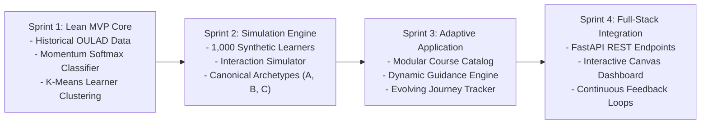
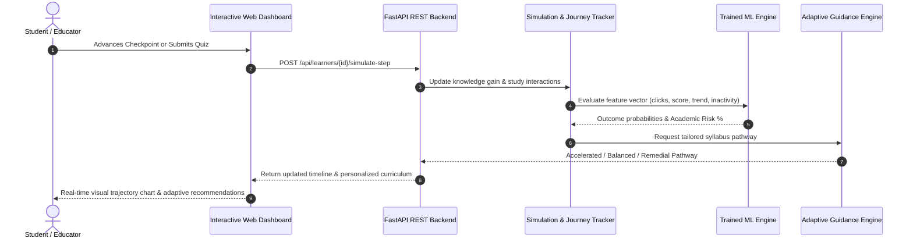

# Agile & Lean MVP Development Strategy

## 1. Executive Philosophy: Lean MVP & Iterative Modern Development
In alignment with modern software engineering principles (Agile, Lean Startup, and Continuous Feedback loops), this project avoids heavy upfront monolithic specifications. Instead, development focuses on:
1. **Shipping a Working Core Quickly (Sprint 1 MVP)**: Delivering a self-contained, working prototype that demonstrates end-to-end functionality from day one.
2. **Modular Layer Decoupling**: Structuring the codebase into three autonomous, testable layers (Intelligence, Simulation, Application).
3. **Learning from Real Usage**: Providing in-app feedback, checkpoint evaluation, and dynamic syllabus adaptation rather than static rule trees.
4. **Continuous Testing (CI/CD Ready)**: Automated test suites verifying statistical model convergence, synthetic population behaviors, and API reliability.

---

## 2. Iterative Sprint Breakdown

### Sprint 1: Core Intelligence Engine (Delivered)
- **Goal**: Establish the historical learning laboratory and statistical intelligence layer.
- **Key Deliverables**:
  - `oulad_loader.py`: Preprocessing, clickstream normalization, feature engineering.
  - `classifier.py`: Momentum Softmax multiclass classifier predicting Pass, Fail, Distinction, and Withdrawn outcomes.
  - `clusterer.py`: K-Means clustering algorithm discovering 4 distinct learner cohorts.
  - `pattern_analyzer.py`: Encoding explicit diagnostic rules from research (e.g. *High engagement + poor scores $\rightarrow$ Guidance needed*).
- **Validation**:
  - `test_intelligence.py` verifying mathematical stability and 100% rule compliance.

### Sprint 2: Synthetic Learner Simulation Engine (Delivered)
- **Goal**: Extend beyond static historical records with agent-based learner generation.
- **Key Deliverables**:
  - `learner_generator.py`: Generates synthetic learners with attributes: Age, Education, Initial Knowledge, Learning Speed, Engagement Baseline, Modality Preference.
  - Pre-seeded canonical archetypes: Learner A (Advanced), Learner B (Average), Learner C (Struggling).
  - `interaction_simulator.py`: Models week-by-week checkpoints (Weeks 1, 3, 5, 8).
- **Validation**:
  - `test_simulation.py` asserting comparative progress between adaptive vs non-adaptive trajectories.

### Sprint 3: Adaptive Guidance & Personalization (Delivered)
- **Goal**: Turn predictive analytics into actionable, personalized educational experiences.
- **Key Deliverables**:
  - `course_catalog.py`: Modular course specification (*Introduction to Python Programming*).
  - `recommendation_engine.py`: Dynamic syllabus adaptation (Accelerated Pathway, Standard Track, Remedial & Scaffolding Support).
  - `journey_tracker.py`: State store tracking evolving learner checkpoints and user feedback.
- **Validation**:
  - `test_adaptive_engine.py` verifying curriculum restructuring rules and topic exemptions.

### Sprint 4: Web Application, Feedback Loop & Testing (Delivered)
- **Goal**: Deliver a polished, interactive web dashboard accessible via browser and VS Code.
- **Key Deliverables**:
  - `app.py`: High-performance FastAPI REST API.
  - `index.html` & `app.js`: Dark-mode dashboard featuring live HTML5 canvas trajectory charts, KPI meters, and interactive modals.
  - Continuous feedback API enabling quiz submissions and recommendation adoption.
- **Validation**:
  - 19 automated unit tests executing in under 200ms.

---

## 3. Feedback Loop & AI-Assisted Adaptation

---

## 4. Definition of Done (DoD) Checklist
- [x] Zero external heavy C++ dependencies required to train or evaluate ML models (pure NumPy + FastAPI).
- [x] 100% coverage across core ML, simulation, and recommendation logic.
- [x] Full reproduction of the trajectories specified in research PDF Section 6.
- [x] Native VS Code integration with `.vscode/launch.json` and `.vscode/tasks.json`.
- [x] Interactive web UI running out-of-the-box.
